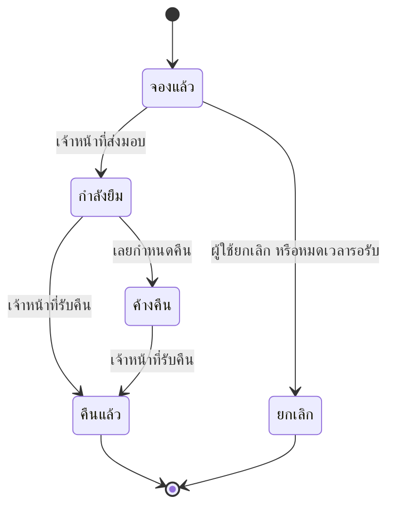

# ลำดับการทำงานของระบบ (System Flows)
## ระบบยืมอุปกรณ์ห้องปฏิบัติการ

อ้างอิงจาก 01-overview.md และ 02-features.md ข้อที่มีเครื่องหมาย **(รอยืนยัน)** มีรายละเอียดใน 05-decisions.md

## สารบัญ Flow
1. Flow 1: จองและรับอุปกรณ์
2. Flow 2: คืนอุปกรณ์และติดตามรายการค้างคืน
3. สถานะของการยืม

## ผู้เกี่ยวข้องในระบบ
- **นักศึกษา** — ผู้ยืม ใช้งานผ่านเว็บบนมือถือ
- **เจ้าหน้าที่ห้องปฏิบัติการ** — ส่งมอบและรับคืนอุปกรณ์ที่เคาน์เตอร์ ใช้เว็บบนคอมพิวเตอร์

ช่องทางและรายละเอียดวิธีทำงานด้านล่างเป็นข้อเสนอ (รอยืนยัน) ตามประเด็นที่ 10 ยกเว้นฟีเจอร์และเพดานจองที่บันทึกจากต้นทางใน 00-source.md ค่าที่เสนอแต่ละเรื่องอ้างประเด็นเพิ่มเติมตรงจุดนั้น

## Flow 1: จองและรับอุปกรณ์

**เงื่อนไขก่อนเริ่ม:** นักศึกษาได้รับบัญชีและเข้าสู่ระบบแล้ว เจ้าหน้าที่เตรียมรายการอุปกรณ์ที่พร้อมให้ยืม (วิธีเตรียมบัญชีและเข้าสู่ระบบรอตัดสินใจ ประเด็นที่ 12; ยังตรวจรับขั้นนี้ไม่ได้)

**ขั้นตอน**
1. นักศึกษาค้นหาอุปกรณ์และเลือกวันรับ ซึ่งต้องไม่เกิน "จำนวนวันจองล่วงหน้าสูงสุด"
2. ระบบตรวจว่าอุปกรณ์ว่างในวันนั้น ถ้าว่าง สร้างการจองสถานะ "จองแล้ว" ถ้าไม่ว่าง แสดงวันที่ว่างถัดไป
3. นักศึกษามาที่เคาน์เตอร์ เจ้าหน้าที่ค้นการจองจากรหัสนักศึกษาใน "หน้าส่งมอบและรับคืน"
4. เจ้าหน้าที่กดส่งมอบ ระบบเปลี่ยนสถานะเป็น "กำลังยืม" และกำหนดวันคืนตาม "ระยะเวลายืมสูงสุด"

**ผลลัพธ์:** การยืมมีสถานะ "กำลังยืม" พร้อมชื่อผู้ยืมและกำหนดคืน

**กรณีอื่น (เมื่อไม่เป็นไปตามปกติ)**
- นักศึกษายกเลิกก่อนรับ: สถานะเป็น "ยกเลิก" อุปกรณ์กลับมาว่างทันที
- ไม่มารับภายใน "เวลารอรับอุปกรณ์": ระบบยกเลิกการจองอัตโนมัติ (รอยืนยัน) ตามประเด็นที่ 1 โดยแสดงสถานะในหน้ารายการของฉัน (รอยืนยัน) ตามประเด็นที่ 10 เวลาปิดห้องจริงยังรอประเด็นที่ 8
- การยกเลิกหรือส่งมอบซ้ำ: รายการที่เปลี่ยนสถานะแล้วไม่ถูกเปลี่ยนหรือสร้างการยืมซ้ำ ถ้ามีคนส่งมอบพร้อมกับยกเลิก ระบบรับการเปลี่ยนสถานะครั้งแรกและแจ้งอีกคนให้โหลดสถานะล่าสุด (รอยืนยัน) ตามประเด็นที่ 10
- นักศึกษาสองคนจองชิ้นเดียวกันพร้อมกัน: ระบบรับเฉพาะรายการที่บันทึกก่อน อีกคนเห็นข้อความว่าอุปกรณ์ไม่ว่างแล้ว

## Flow 2: คืนอุปกรณ์และติดตามรายการค้างคืน

**เงื่อนไขก่อนเริ่ม:** มีการยืมสถานะ "กำลังยืม" หรือ "ค้างคืน"

**ขั้นตอน**
1. เมื่อถึง "เวลาแจ้งเตือนก่อนครบกำหนดคืน" ระบบแจ้งเตือนนักศึกษา (รอยืนยัน) ตามประเด็นที่ 7 ช่องทางรอตัดสินใจตามประเด็นที่ 2
2. เมื่อเลยกำหนดคืน ระบบเปลี่ยนสถานะเป็น "ค้างคืน" และแสดงใน "หน้ารายการค้างคืน" (รอยืนยัน) ตามประเด็นที่ 10 การคืนก่อนครบกำหนดทำได้โดยข้ามขั้นแจ้งเตือนและค้างคืนไปขั้นรับคืน
3. นักศึกษานำอุปกรณ์มาคืน เจ้าหน้าที่กดรับคืนและเลือกสภาพ ปกติ หรือ ชำรุด
4. ระบบเปลี่ยนสถานะการยืมเป็น "คืนแล้ว" ถ้าสภาพปกติ อุปกรณ์กลับมาพร้อมให้ยืม ถ้าชำรุด อุปกรณ์เปลี่ยนเป็นปิดการใช้งานจนเจ้าหน้าที่แก้ไข

**ผลลัพธ์:** การยืมมีสถานะ "คืนแล้ว" และรายการค้างคืนลดลง

**กรณีอื่น (เมื่อไม่เป็นไปตามปกติ)**
- ส่งแจ้งเตือนไม่สำเร็จ: ลองใหม่ตาม "จำนวนครั้งส่งแจ้งเตือนซ้ำสูงสุด" และ "ช่วงห่างส่งแจ้งเตือนซ้ำ" หากครบแล้วยังไม่สำเร็จ แสดงผลให้เจ้าหน้าที่ติดตาม การเรียกส่งงานซ้ำไม่สร้างข้อความใหม่สำหรับการยืมและรอบเตือนเดิม (รอยืนยัน) ตามประเด็นที่ 9 ต้องตรวจความเป็นไปได้ของช่องทางก่อนยืนยันผลซ้ำ
- งานเปลี่ยนสถานะรันซ้ำ: การยืมที่เป็น "ค้างคืน" อยู่แล้วไม่ถูกเปลี่ยนซ้ำ รับคืนซ้ำไม่สร้างประวัติคืนเพิ่ม (รอยืนยัน) ตามประเด็นที่ 10
- อุปกรณ์สูญหาย: ห้ามบันทึกว่าคืนจริง ให้ส่งเรื่องให้อาจารย์และคงสถานะค้างคืนไว้ระหว่างรอคำสั่ง วิธีปิดเรื่อง ผู้มีสิทธิ์ และหลักฐานรอตัดสินใจตามประเด็นที่ 13 เป็นช่องว่างที่ต้องปิดก่อนเริ่มพัฒนาส่วนสถานะ

## สถานะของการยืม

| สถานะ | ความหมาย | เปลี่ยนมาจาก | เปลี่ยนไปเป็น |
|---|---|---|---|
| จองแล้ว | นักศึกษาจองแล้ว ยังไม่รับของ | จุดเริ่มต้น | กำลังยืม, ยกเลิก |
| กำลังยืม | รับของแล้ว ยังไม่ถึงกำหนดคืน | จองแล้ว | คืนแล้ว, ค้างคืน |
| ค้างคืน | เลยกำหนดคืนแล้วยังไม่คืน | กำลังยืม | คืนแล้ว |
| คืนแล้ว | เจ้าหน้าที่รับคืนแล้ว | กำลังยืม, ค้างคืน | สถานะสุดท้าย ข้อเสนอให้แก้ย้อนหลังไม่ได้ ต้องยืนยันวิธีแก้รายการผิดตามประเด็นที่ 13 |
| ยกเลิก | ยกเลิกก่อนรับของ | จองแล้ว | สถานะสุดท้าย |

## ค่าที่ตั้งได้ในระบบ
| ชื่อค่า | ค่าเริ่มต้น | ใช้ที่ใด |
|---|---|---|
| จำนวนวันจองล่วงหน้าสูงสุด | 3 วัน (ตัดสินใจแล้ว ประเด็นที่ 6) | Flow 1 |
| ระยะเวลายืมสูงสุด | 7 วัน (รอยืนยัน) ตามประเด็นที่ 1 | Flow 1, Flow 2 |
| เวลารอรับอุปกรณ์ | ถึงเวลาปิดห้องของวันที่จองรับ (รอยืนยัน) ตามประเด็นที่ 1 | Flow 1 |
| เวลาแจ้งเตือนก่อนครบกำหนดคืน | 1 วัน (รอยืนยัน) ตามประเด็นที่ 7 | Flow 2 |
| จำนวนครั้งส่งแจ้งเตือนซ้ำสูงสุด | 1 ครั้ง (รอยืนยัน) ตามประเด็นที่ 9 | Flow 2 |
| ช่วงห่างส่งแจ้งเตือนซ้ำ | 1 ชั่วโมง (รอยืนยัน) ตามประเด็นที่ 9 | Flow 2 |

เวลาปิดห้องจริงยังรอระบุ ตามประเด็นที่ 8 ค่าที่อิงเวลาปิดห้องจึงยังนำไปตรวจรับไม่ได้
