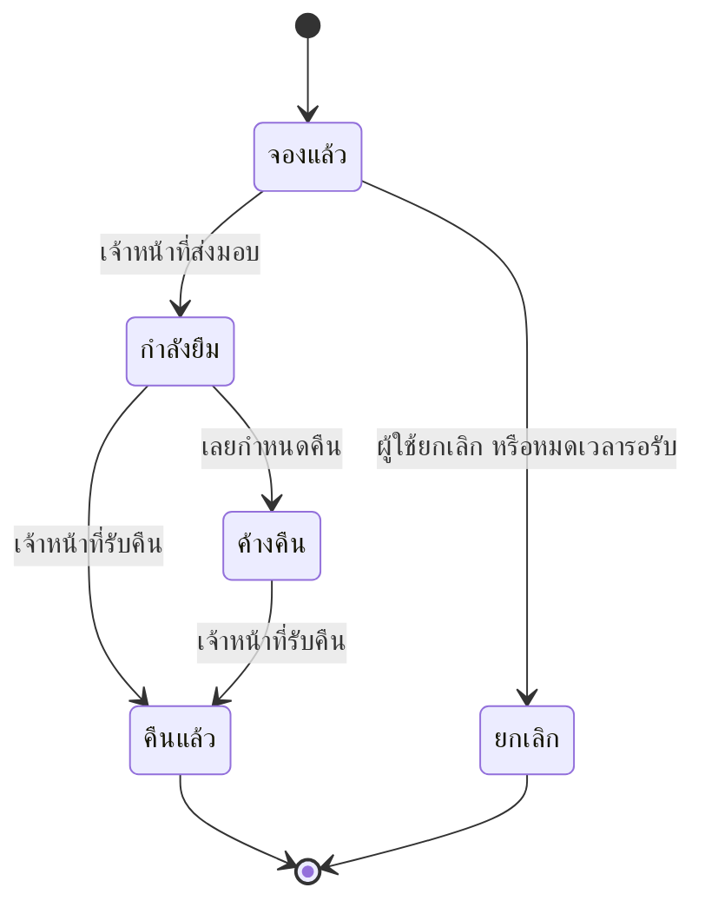

# ลำดับการทำงานของระบบ (System Flows)
## ระบบยืมอุปกรณ์ห้องปฏิบัติการ

อ้างอิงจาก 01-overview.md และ 02-features.md ข้อที่มีเครื่องหมาย **(รอยืนยัน)** มีรายละเอียดใน 05-decisions.md

## สารบัญ Flow
1. Flow 1: จองและรับอุปกรณ์
2. Flow 2: คืนอุปกรณ์และติดตามรายการค้างคืน
3. สถานะของการยืม

## ผู้เกี่ยวข้องในระบบ
- **นักศึกษา** — ผู้ยืม ใช้งานผ่านเว็บบนมือถือ
- **เจ้าหน้าที่ห้องปฏิบัติการ** — ส่งมอบและรับคืนอุปกรณ์ที่เคาน์เตอร์ ใช้เว็บบนคอมพิวเตอร์

## Flow 1: จองและรับอุปกรณ์

**เงื่อนไขก่อนเริ่ม:** นักศึกษาเข้าสู่ระบบแล้ว และอุปกรณ์ที่ต้องการมีสถานะพร้อมให้ยืม

**ขั้นตอน**
1. นักศึกษาค้นหาอุปกรณ์และเลือกวันรับ ซึ่งต้องไม่เกิน "จำนวนวันจองล่วงหน้าสูงสุด"
2. ระบบตรวจว่าอุปกรณ์ว่างในวันนั้น ถ้าว่าง สร้างการจองสถานะ "จองแล้ว" ถ้าไม่ว่าง แสดงวันที่ว่างถัดไป
3. นักศึกษามาที่เคาน์เตอร์ เจ้าหน้าที่ค้นการจองจากรหัสนักศึกษาใน "หน้าส่งมอบและรับคืน"
4. เจ้าหน้าที่กดส่งมอบ ระบบเปลี่ยนสถานะเป็น "กำลังยืม" และกำหนดวันคืนตาม "ระยะเวลายืมสูงสุด"

**ผลลัพธ์:** การยืมมีสถานะ "กำลังยืม" พร้อมชื่อผู้ยืมและกำหนดคืน

**กรณีอื่น (เมื่อไม่เป็นไปตามปกติ)**
- นักศึกษายกเลิกก่อนรับ: สถานะเป็น "ยกเลิก" อุปกรณ์กลับมาว่างทันที
- ไม่มารับภายใน "เวลารอรับอุปกรณ์": ระบบยกเลิกการจองอัตโนมัติ (รอยืนยัน) และแจ้งนักศึกษา
- นักศึกษาสองคนจองชิ้นเดียวกันพร้อมกัน: ระบบรับเฉพาะรายการที่บันทึกก่อน อีกคนเห็นข้อความว่าอุปกรณ์ไม่ว่างแล้ว

## Flow 2: คืนอุปกรณ์และติดตามรายการค้างคืน

**เงื่อนไขก่อนเริ่ม:** มีการยืมสถานะ "กำลังยืม" หรือ "ค้างคืน"

**ขั้นตอน**
1. ก่อนครบกำหนดคืน 1 วัน ระบบแจ้งเตือนนักศึกษา (ช่องทางรอตัดสินใจ ประเด็นที่ 2)
2. เมื่อเลยกำหนดคืน ระบบเปลี่ยนสถานะเป็น "ค้างคืน" ทุกเช้า และแสดงใน "หน้ารายการค้างคืน"
3. นักศึกษานำอุปกรณ์มาคืน เจ้าหน้าที่กดรับคืนและเลือกสภาพ ปกติ หรือ ชำรุด
4. ระบบเปลี่ยนสถานะการยืมเป็น "คืนแล้ว" ถ้าสภาพปกติ อุปกรณ์กลับมาพร้อมให้ยืม ถ้าชำรุด อุปกรณ์เปลี่ยนเป็นปิดการใช้งานจนเจ้าหน้าที่แก้ไข

**ผลลัพธ์:** การยืมมีสถานะ "คืนแล้ว" และรายการค้างคืนลดลง

**กรณีอื่น (เมื่อไม่เป็นไปตามปกติ)**
- ส่งแจ้งเตือนไม่สำเร็จ: ระบบลองใหม่ 1 ครั้งในชั่วโมงถัดไป ถ้ายังไม่สำเร็จจะไม่ส่งซ้ำอีก การยืมนั้นยังขึ้นใน "หน้ารายการค้างคืน" เมื่อเลยกำหนด เจ้าหน้าที่จึงติดตามได้
- งานเปลี่ยนสถานะตอนเช้ารันซ้ำ: การยืมที่เป็น "ค้างคืน" อยู่แล้วไม่ถูกเปลี่ยนซ้ำ จึงไม่เกิดผลซ้ำซ้อน
- อุปกรณ์สูญหาย: เจ้าหน้าที่บันทึกรับคืนไม่ได้ ต้องแจ้งอาจารย์ดูแลห้อง และการยืมยังอยู่ในรายการค้างคืน (วิธีปิดเรื่องรอระเบียบคณะ เฟสหลัง)

## สถานะของการยืม

| สถานะ | ความหมาย | เปลี่ยนมาจาก | เปลี่ยนไปเป็น |
|---|---|---|---|
| จองแล้ว | นักศึกษาจองแล้ว ยังไม่รับของ | จุดเริ่มต้น | กำลังยืม, ยกเลิก |
| กำลังยืม | รับของแล้ว ยังไม่ถึงกำหนดคืน | จองแล้ว | คืนแล้ว, ค้างคืน |
| ค้างคืน | เลยกำหนดคืนแล้วยังไม่คืน | กำลังยืม | คืนแล้ว |
| คืนแล้ว | เจ้าหน้าที่รับคืนแล้ว | กำลังยืม, ค้างคืน | สถานะสุดท้าย แก้ไขย้อนหลังไม่ได้ |
| ยกเลิก | ยกเลิกก่อนรับของ | จองแล้ว | สถานะสุดท้าย |

## ค่าที่ตั้งได้ในระบบ
| ชื่อค่า | ค่าเริ่มต้น | ใช้ที่ใด |
|---|---|---|
| จำนวนวันจองล่วงหน้าสูงสุด | 3 วัน (ตัดสินใจแล้ว ประเด็นที่ 6) | Flow 1 |
| ระยะเวลายืมสูงสุด | 7 วัน (รอยืนยัน) ตามประเด็นที่ 1 | Flow 1, Flow 2 |
| เวลารอรับอุปกรณ์ | ถึงเวลาปิดห้องของวันที่จองรับ (รอยืนยัน) ตามประเด็นที่ 1 | Flow 1 |
| เวลาแจ้งเตือนก่อนครบกำหนดคืน | 1 วัน (รอยืนยัน) ตามประเด็นที่ 7 | Flow 2 |
